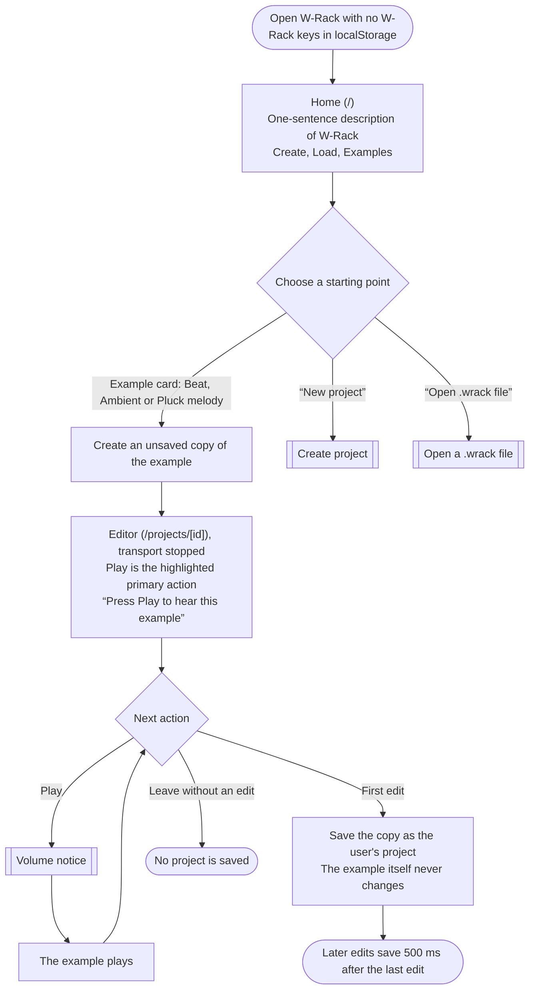
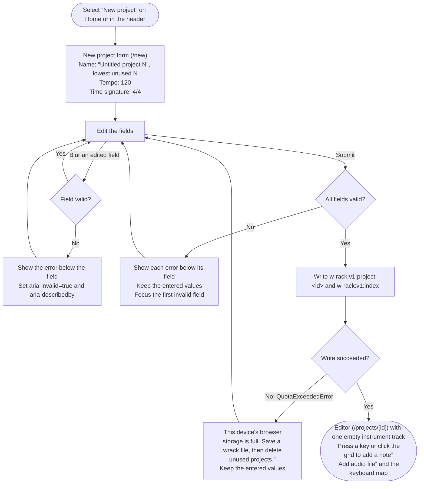
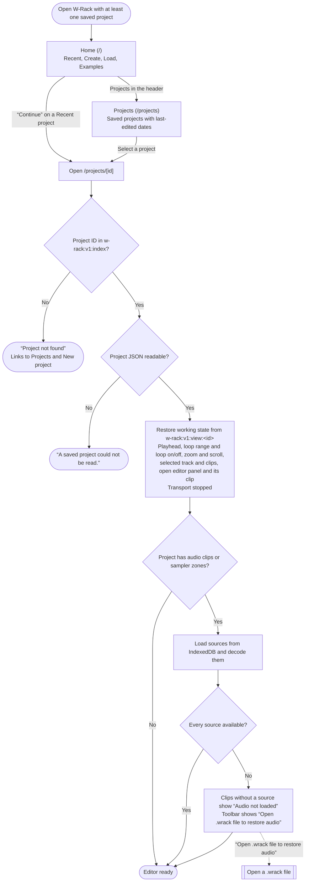
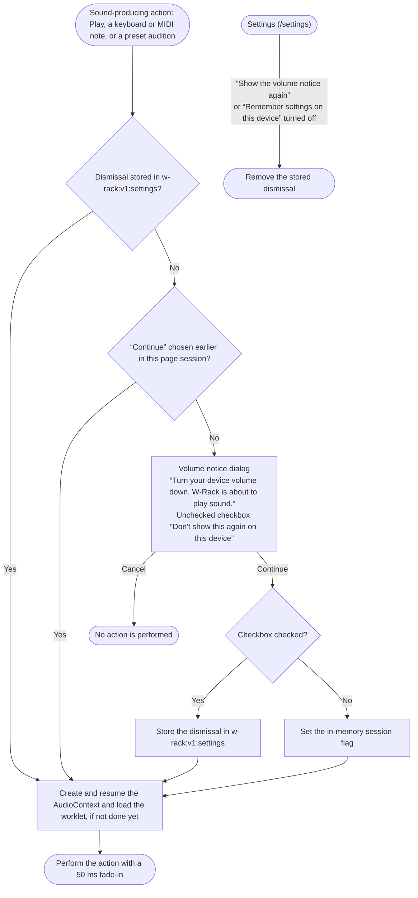
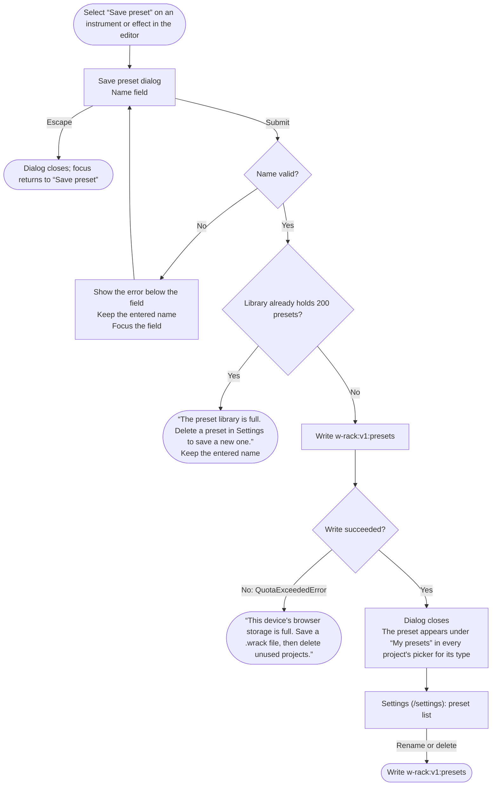
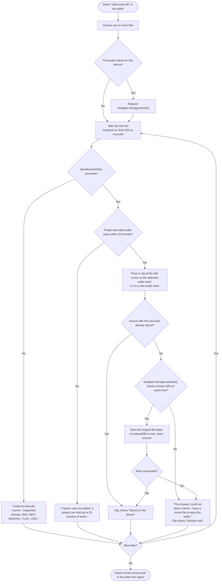
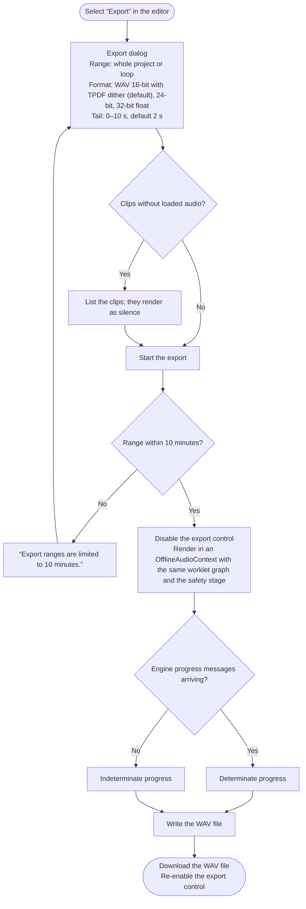
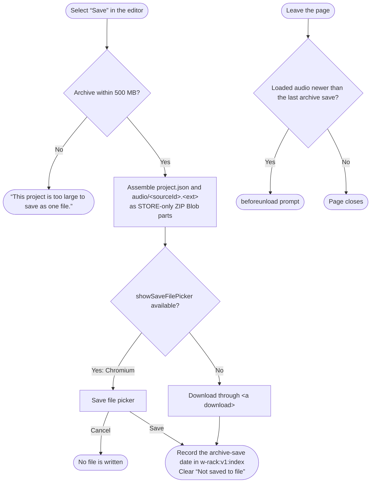
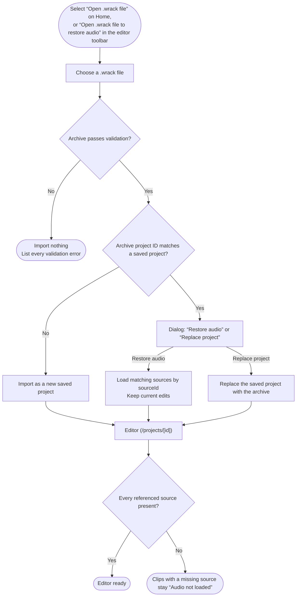
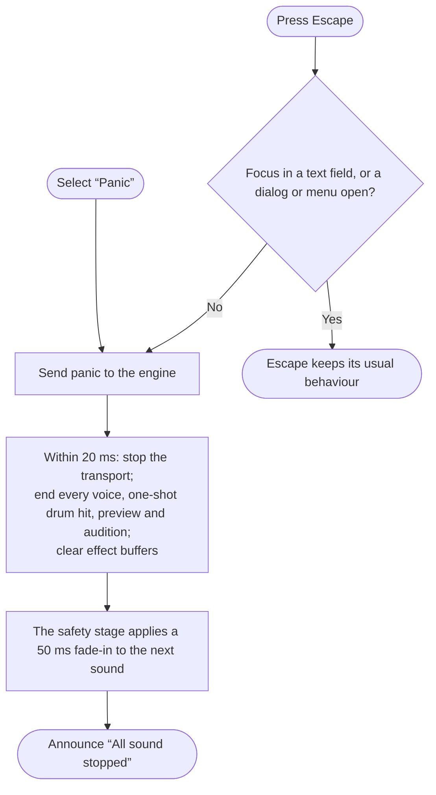

# W-Rack

W-Rack is a digital audio workstation that runs in the browser. It combines MIDI tracks played by built-in instruments, audio tracks with imported clips, track and master effects, WAV export and `.wrack` project files. The site is static: all audio processing and storage happen on the user's device.

## User flows

The diagrams in this section are maintained in [`flows.md`](flows.md).

Each flowchart describes one W-Rack user flow. Rounded nodes are entry and exit points, rectangles are screens and actions, diamonds are decisions, and double-bordered nodes link to another flow. Text in curly quotes is interface copy from `docs/assignment-3-scope.md`.

### First visit

A first visit is a visit with no W-Rack keys in `localStorage`.

### Create project

| Field | Rule | Error text |
|---|---|---|
| Name | 1–60 characters after trimming | “Enter a project name.” / “Use 60 characters or fewer.” |
| Tempo | Integer 40–240 | “Enter a tempo between 40 and 240.” |
| Time signature | 2/4, 3/4, 4/4 or 6/8 | — |

### Return visit

A return visit is a visit with at least one saved project.

### Volume notice

The first sound-producing action of a page session passes through this flow.

### Save preset

| Field | Rule | Error text |
|---|---|---|
| Name | 1–40 characters after trimming; unique within the instrument or effect type | “Enter a preset name.” / “Use 40 characters or fewer.” / “A preset with this name already exists for &lt;type&gt;. Choose another name.” |

### Import audio

### Export WAV

### Save a .wrack file

### Open a .wrack file

Validation rejects an archive with any of these properties:
- A `..`, absolute or backslash path.
- More than 1000 entries.
- Duplicate paths, compared case-insensitively.
- A compression method other than 0.
- The encryption flag set.
- Sizes inconsistent with the file.
- A total size above 500 MB.
- A `project.json` above 5 MB or with JSON depth above 64.
- A CRC-32 mismatch.

### Panic

### Route coverage

| Route | Flows |
|---|---|
| `/` | First visit, Return visit, Open a .wrack file |
| `/new` | First visit, Create project |
| `/projects` | Return visit |
| `/projects/[id]` | First visit, Create project, Return visit, Save preset, Import audio, Export WAV, Save a .wrack file, Open a .wrack file, Panic |
| `/settings` | Volume notice, Save preset |
| Unknown project ID | Return visit |

## Onboarding research

The full study, with sources and confidence labels, is in [`docs/onboarding-research.md`](docs/onboarding-research.md). It compares the first-run experience of BandLab Studio, Chrome Music Lab Song Maker and Ableton Live 12, each researched by an independent agent against official documentation, help-center articles and, for Song Maker, the production code.

### Findings

| ID | Finding | BandLab Studio | Song Maker | Ableton Live 12 |
|---|---|---|---|---|
| F1 | Gate before content | Account | None | Account, installation, authorization |
| F2 | Actions to first sound | 5 after sign-in | 1 (place a note) | 3 on first launch with the demo Set |
| F3 | Empty-state strategy | New Track pop-up | Playable grid | Demo Set, then an empty Default Set |
| F4 | Sound starts on | User action | User action | User action |
| F5 | Fields before work | Track type | None | None |
| F6 | Learning model | Tutorial from the Help menu | Learning by doing | Lessons beside the work |
| F7 | Return memory | Cloud Library | Server share link | Recent Sets, crash restore |
| F8 | Level safety | Red master meter | Fixed −6 dB levels | No default limiter |
| F9 | Browser audio rule | Gesture required | Resumes on first note | Not applicable |
| F10 | Permission requests | When a device is used | Web MIDI on load | None |
| F11 | Unsaved work | Manual save | Lost unless saved | Manual save, crash restore |

### Decisions

| Decision | Findings |
|---|---|
| No account, permission request or form before content | F1, F10 |
| Examples on every visit; Recent first on return visits | F3, F7 |
| An example reaches first sound in two actions: open the card, press Play | F2 |
| Examples open stopped, with Play highlighted and the hint "Press Play to hear this example"; cards on Home do not preview sound | F4, F9 |
| Examples are MIDI-only and open as a copy that saves on first edit | F2, F3 |
| A volume notice precedes the first sound of a session, and its `Continue` resumes the `AudioContext` | F8, F9 |
| The master defaults to −12 dB, with a fixed safety limiter last | F8 |
| `/new` asks for three prefilled fields, with inline errors that keep input | F5 |
| Empty regions offer the next action, and placing a note previews it | F2, F3, F6 |
| Help appears in context; there is no modal tour | F6 |
| Return visits restore the working state with the transport stopped; imported audio persists on the device | F7 |
| Web MIDI access is requested only from a button | F10 |
| Edits save locally 500 ms after the last change, with a visible save status | F11 |

## First-run check

The main flow was run in Chromium, Firefox and WebKit with empty profiles against the production build: no sound before a user action, Home, an example played after the volume notice, a new project, a saved preset, a return visit with the working state restored, WAV export and a `.wrack` round trip. Every step passed, and the site made no third-party requests. The review as a brand-new and as a returning user led to these changes:

- An empty clip opens with Step input on, so pressing a key adds a note, as the empty-editor hint says.
- The editor shows the transport, tracks, timeline and piano roll first; live input and view settings come last.
- The timeline has a bar-number ruler and track names.
- Save .wrack file and Load explain what a `.wrack` file is and that edits save in the browser automatically.
- Each instrument and effect shows its current preset.
- Split and Join are disabled until the project has clips; effect cards no longer overflow.

The full results, the feedback and what was not changed are in [`docs/first-run-check.md`](docs/first-run-check.md).

## Features

| Area | What W-Rack provides |
|---|---|
| Editor | One screen without page scrolling: project header, transport, arrangement with track headers, a resizable dock with Editor, Devices and Mixer tabs, and a help strip that describes the control under the pointer or in focus |
| Instruments | Subtractive, FM, additive, pluck (Karplus–Strong), granular, a 14-voice drum machine with General MIDI note mapping, and a sampler with a keyboard-operable sample editor |
| MIDI | Piano roll with keyboard note entry, step input, a velocity lane, quantize and clip looping; Add instrument track opens a four-bar clip in the piano roll; computer-keyboard and Web MIDI live input |
| Audio | Multi-file import, waveform timeline with a bar ruler and a keyboard treegrid, marquee selection, a clip menu (right-click, Shift+F10), split, join, trim, move, duplicate, fades, crossfades, clip gain and gain envelopes, editable by on-clip handles or numeric fields |
| Effects | EQ, filter, compressor, saturation, distortion (soft clip, hard clip, foldback), delay and reverb in chains of up to eight on every track and the master |
| Mixer | Track gain, pan, mute and solo; master volume and pan; meters with peak hold and latched clip indicators; limiter gain reduction; Panic (`Escape`) |
| Safety | A fixed safety stage after the master: guard, DC blocker, sustained-level duck, −1 dBFS limiter and a 50 ms start fade |
| Projects | Automatic local saving, restored working state, project lists with tempo, time signature, track count and origin, rename and duplicate, a personal preset library with auditions, `.wrack` archives, WAV export with progress, Cancel and Download |
| Commands | A command palette (Ctrl+K or Ctrl+Shift+P, Cmd on macOS, or the header's Commands button) that searches and runs every command with its shortcut; `?` lists every shortcut; single-key shortcuts for loop (L), metronome (K), snap (G) and grid (+, −) |

All audio runs in one AudioWorklet engine followed by the safety stage; no native Web Audio DSP nodes are used. Implementation details are in [`docs/a3-audio-implementation.md`](docs/a3-audio-implementation.md).

## Browser support

| Browser | Status |
|---|---|
| Chrome and Edge (Chromium) | Supported. Web MIDI is available after its permission prompt. `.wrack` files save through the file picker. |
| Firefox | Supported. Web MIDI needs Firefox's site-permission add-on; connect the MIDI device before starting Firefox. Files save as downloads. |
| Safari (WebKit) | Supported without Web MIDI. Safari can delete site data after 7 days without a visit, so `.wrack` backups are recommended; private windows keep imported audio for the session only. Files save as downloads. |

The end-to-end suite runs in Chromium, Firefox and WebKit.

## Storage

| Data | Where |
|---|---|
| Projects, working state, presets, settings | `localStorage`, keys starting with `w-rack:v1:` |
| Imported audio (original file bytes) | IndexedDB database `w-rack`, store `sources` |

Nothing leaves the device. `/settings` shows storage use, lists stored audio with the projects that use it, and offers "Clear all data".

## Limits

| Limit | Value |
|---|---|
| Tracks | 16 |
| Voices | 16 per instrument, 64 in total |
| Effects per chain | 8; at most 4 reverbs per project |
| Decoded audio per project | 20 minutes |
| Sampler source | 60 s; mip memory 64 MB in total |
| Expanded MIDI notes per track | 20 000 |
| Export | 10 minutes plus a tail of up to 10 s |
| `.wrack` archive | 500 MB |
| Presets | 200 |

The full list is in [`docs/assignment-3-scope.md`](docs/assignment-3-scope.md) (Limits).

## Accessibility

W-Rack targets WCAG 2.2 AA. Canvas views have DOM mirrors: the timeline is a `treegrid` named "Tracks and clips" and the piano roll a `grid` named "Notes". Every control has a role and a name that is unique within its landmark.

| Pair | Contrast |
|---|---|
| Text on background | 12.4:1 |
| Muted text on background | 5.6:1 |
| Control boundaries on background | 3.7:1 |
| Focus ring on background | 5.1:1 |
| Primary button text | 5.0:1 |

The checks, keyboard paths and known gaps are recorded in [`docs/a11y-check.md`](docs/a11y-check.md).

## Development

Node 24 and the Playwright browsers install under `.tools/` (git-ignored); every command runs with `PATH=$PWD/.tools/node/bin:$PATH`.

| Command | Purpose |
|---|---|
| `pnpm dev` | Development server; worklet sources are copied to `public/worklets/` and watched |
| `pnpm build` | Static export to `out/` |
| `pnpm start` | Serves `out/` on port 3100 with the rewrites and headers in `vercel.json` |
| `pnpm lint` | ESLint, including the audio-thread rules for `src/dsp` and `src/worklet` |
| `pnpm test:dsp` | Unit tests in Node (`tests/dsp`) |
| `pnpm e2e:install` | Installs Chromium, Firefox and WebKit into `.tools/ms-playwright` |
| `pnpm test:e2e` | End-to-end tests in the three browsers against `out/`, or against `BASE_URL` when set; the CPU benchmark runs last, alone |

Deployment: Vercel runs `pnpm build` and serves `out/` with `vercel.json`, which rewrites every `/projects/<id>` path to the prerendered editor shell and serves `/worklets/` with `Cache-Control: no-cache`.
