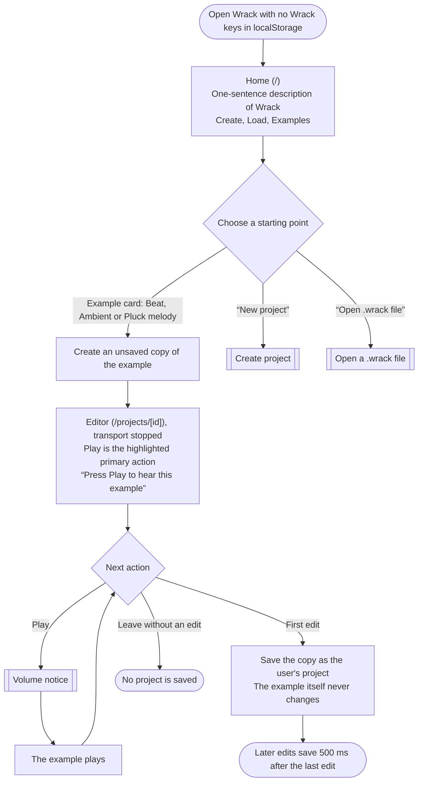
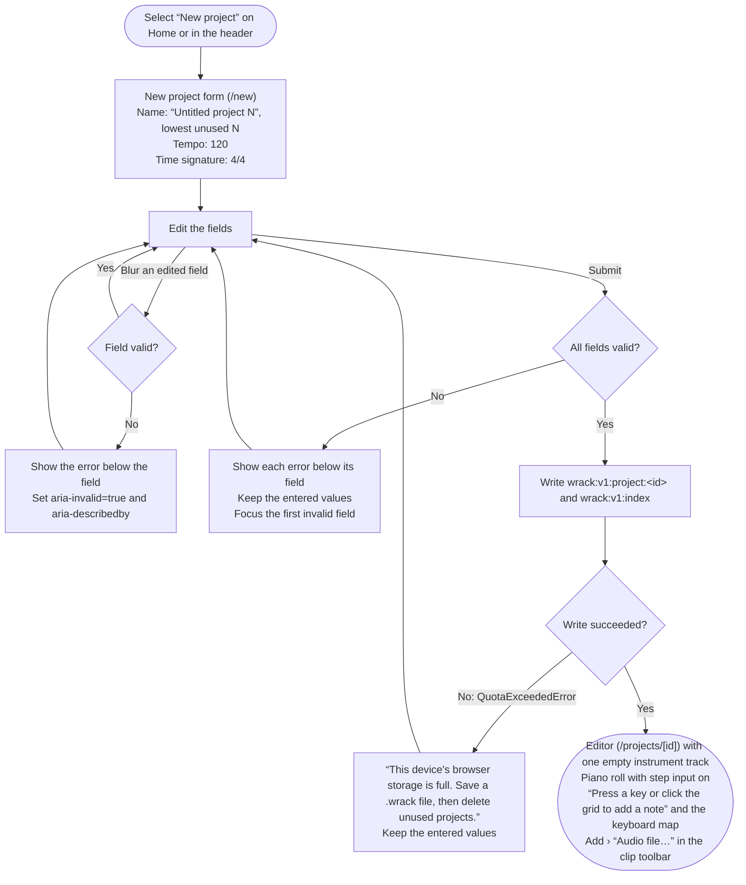
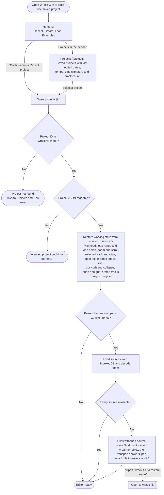
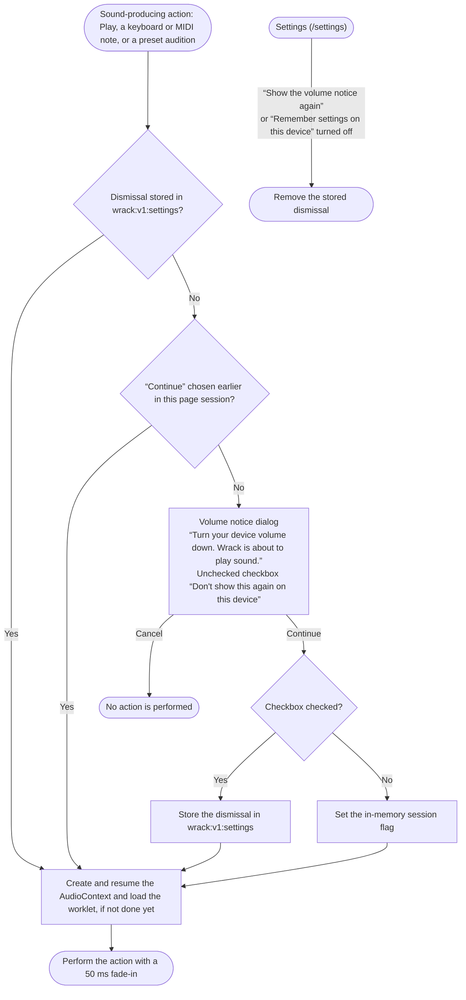
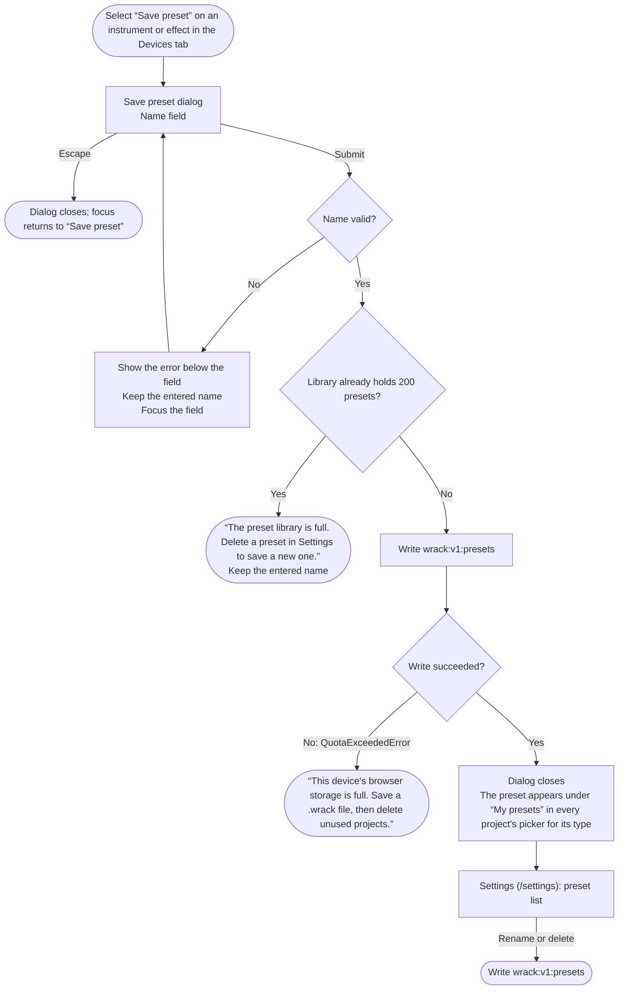
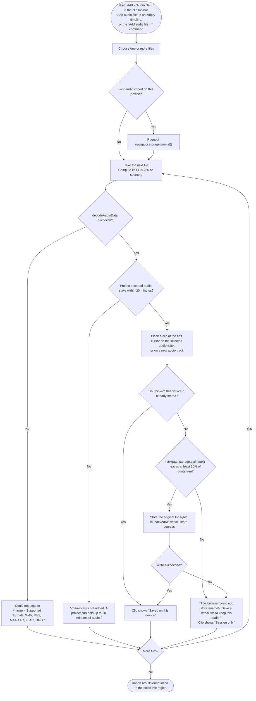
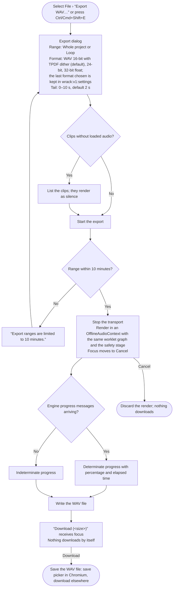
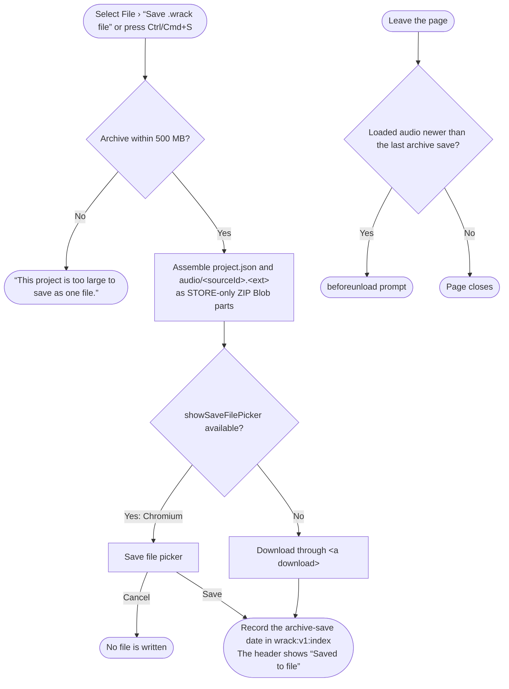
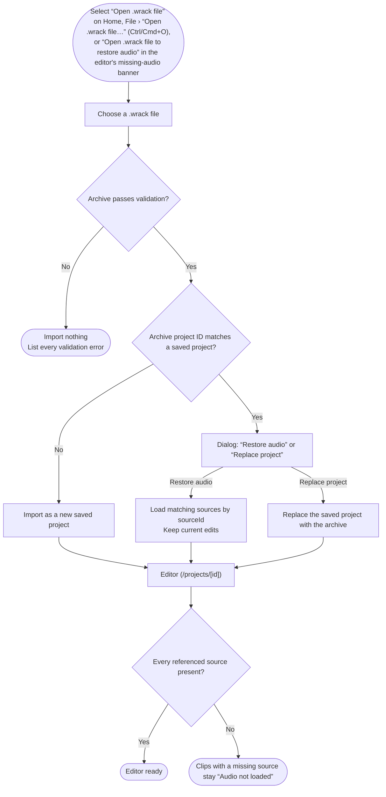
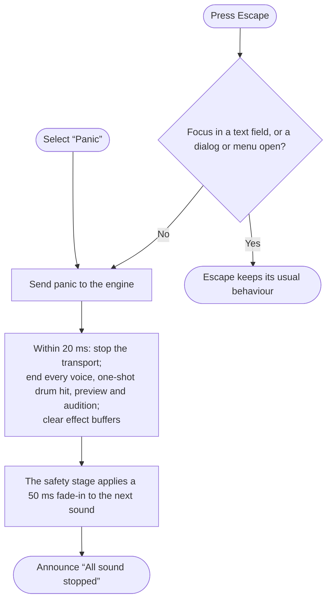

# User flows

The main task, as one sentence:

> I open an example or start a project → I add notes and clips and play them back → I come back later, and the project opens where I left it.

Each flowchart describes one Wrack user flow. Rounded nodes are entry and exit points, rectangles are screens and actions, diamonds are decisions, and double-bordered nodes link to another flow. Text in curly quotes is interface copy.

## First visit

A first visit is a visit with no Wrack keys in `localStorage`.

## Create project

| Field | Rule | Error text |
|---|---|---|
| Name | 1–60 characters after trimming | “Enter a project name.” / “Use 60 characters or fewer.” |
| Tempo | Integer 40–240 | “Enter a whole-number tempo from 40 to 240.” |
| Time signature | 2/4, 3/4, 4/4 or 6/8 | — |

## Return visit

A return visit is a visit with at least one saved project.

## Volume notice

The first sound-producing action of a page session passes through this flow.

## Save preset

| Field | Rule | Error text |
|---|---|---|
| Name | 1–40 characters after trimming; unique within the instrument or effect type | “Enter a preset name.” / “Use 40 characters or fewer.” / “A preset with this name already exists for &lt;type&gt;. Choose another name.” |

## Import audio

## Export WAV

## Save a .wrack file

## Open a .wrack file

Validation rejects an archive with any of these properties:
- A `..`, absolute or backslash path.
- More than 1000 entries.
- Duplicate paths, compared case-insensitively.
- A compression method other than 0.
- The encryption flag set.
- Sizes inconsistent with the file.
- A total size above 500 MB.
- A `project.json` above 5 MB or with JSON depth above 64.
- A CRC-32 mismatch.

## Panic

## Route coverage

| Route | Flows |
|---|---|
| `/` | First visit, Return visit, Open a .wrack file |
| `/new` | First visit, Create project |
| `/projects` | Return visit |
| `/projects/[id]` | First visit, Create project, Return visit, Save preset, Import audio, Export WAV, Save a .wrack file, Open a .wrack file, Panic |
| `/settings` | Volume notice, Save preset |
| Unknown project ID | Return visit |
